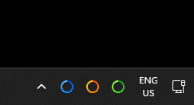

# BatteryTray

Windows tray app that shows the battery of wireless 2.4 GHz keyboards, mice, and headsets. Each device has its own icon.



Blue is the keyboard, yellow-orange is the mouse, and green is the headset. A full ring is 100%. Hover an icon for the name and percent.

## Build

Windows already includes the compiler this uses. From this folder:

```bat
build.bat
```

That writes `BatteryTray.exe` beside the source. Run that file. The repository keeps the source; you build the program on your PC.

## Use

Right-click an icon:

- The first line is that device's level
- **Refresh now** reads every device immediately
- **Reconnect Razer receiver** restarts the Barracuda X 2.4 dongle (Windows asks for administrator approval if needed)
- **Start with Windows**
- **Exit**

Reads are spaced out so the devices can still sleep: keyboard every 10 minutes, mouse every 15 minutes, headset every 30 minutes. The last percent stays on the icon between reads. At 15% or below, a notification appears once, until the battery rises or charging starts.

## Devices

These three icons are always there:

| Icon | Device |
| --- | --- |
| Blue | CompX / AULA 2.4 GHz keyboard (`3554:FA09`) |
| Yellow-orange | Attack Shark X6 (`1D57:FA60`) |
| Green | Razer Barracuda X 2.4 (`1532:0552`) |

Another icon appears only while that receiver is plugged in:

- Other CompX keyboards that use the same report
- Other Attack Shark-style mice (`1D57` or `3554`)
- Razer Barracuda Pro (`1532:053A`)
- Logitech Lightspeed, Unifying, and Bolt receivers that speak HID++ 2.0 and report battery (feature `0x1004` or `0x1000`)

## Razer dongle after a full shutdown

After the PC is powered off completely, the Barracuda X 2.4 receiver can be missing from the sound output until it is unplugged and plugged back in. About 20 seconds after sign-in, if **Speakers (Razer Barracuda X 2.4)** is missing, the app cycles that USB port. **Reconnect Razer receiver** does the same thing from the menu.
